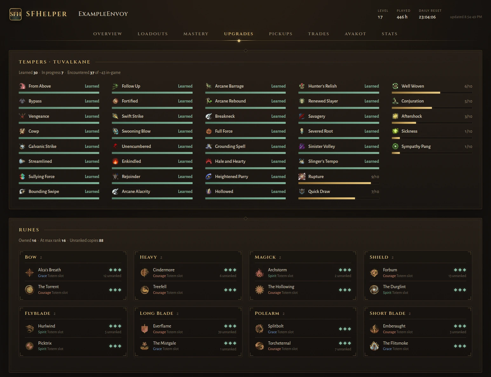
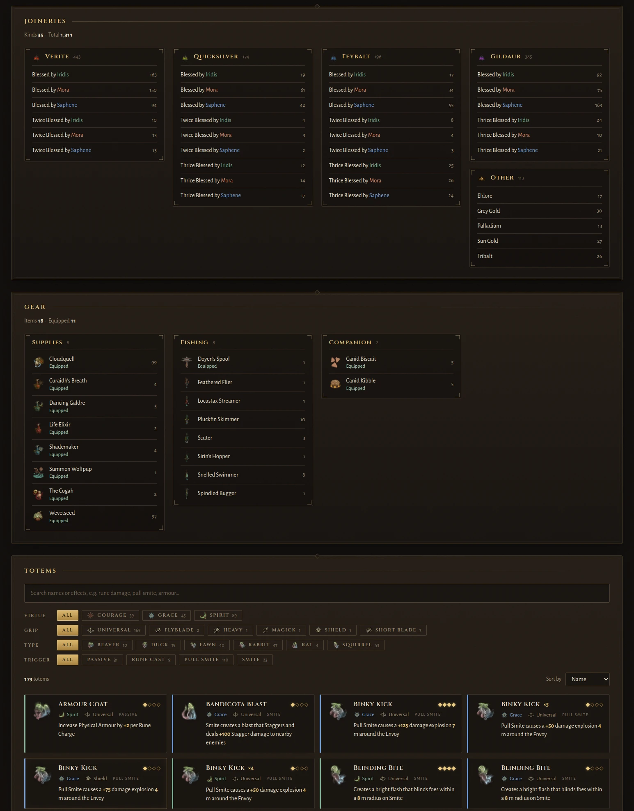

# SFHelper

A desktop companion for **Soulframe**, in the spirit of
[WFHelper](https://github.com/WFHelper/WFHelper). It tracks your faction
standing, mastery, loadouts, totems, weapon pickups and trades while you play, using
in-game names throughout.

Runs on **Linux** (AppImage) and **Windows** (installer or portable zip).


## Features

| Tab | What it shows |
|---|---|
| **Overview** | Faction standing and titles, the daily standing cap counting down, standing earned today per faction, faction tokens and currencies. Cooldowns: the game's own timers counting down, such as an Agari (sub-boss) respawning 30 minutes after you slay it, a siege's cooldown, the 3 hours before an Organ can be destroyed again, and the 24 hours between Blessed Meetings. Star a cooldown to get a desktop notification when it ends. When the Collector docks in your game, Cooldowns shows the region and when it leaves; star Collector Event to be notified. |
| **Loadouts** | Each loadout's Pact (with its Pact Arts tree), weapons, Runes, Totems by slot, Tempers and Joinery (e.g. *Gildaur: Thrice Blessed by Mora*), plus its armour (Helm, Cuirass, Leggings, with defence and Virtue requirements) and Talisman. Virtue totals match the Arsenal, with a breakdown: allocated points, Pact Arts, Talisman and Fables. Pact Arts show the game's own numbers (e.g. Forestall's chance to survive). Loadouts can be shared as short `SFH1:` codes; paste one and press Enter or Import. |
| **Mastery** | Your Envoy Rank, your Mastery and progress to the next rank, and the patch's maximum rank. Every weapon and pact shows its Mastery, which comes from the game's own record, so a re-crafted weapon still counts. Filter by owned, mastered and type (weapons, Primary, Sidearm or Pacts). Discoveries lists every place by its in-game name, whether you've found it, and the Memories found there. |
| **Upgrades** | Tuvalkane temper learning; your Runes by weapon art with their rank, the Totem slot they add and their numbers at that rank; your Joineries by metal and blessing; your Gear, with what's equipped; and your Totem inventory with search and grip / Virtue / type filters. |
| **Recipes** | Everything you can brew with the Witch Verminia (Elixirs, Pup Treats and Palettes) and the Chordstones Tuvalkane casts: each recipe's ingredients against what you have, what you're short of, the Dracs and time it takes, and the Bond rank it needs. Filter by station, or by what's ready to make. |
| **Pickups** | Weapons you've picked up, with times taken from the game's log. Optional desktop notifications for Moonsteel finds. Pickup and trade history is kept on your computer; export it to move it to a new install. |
| **Trades** | Your trade history: who you traded with, what you received and gave, with in-game icons (weapons with their craftwork and tempers), and the Dracs spent on Scutage. Plus how many trades you have left today. |
| **Avakot** | What Avakot's Gots has in stock right now, with prices, purchase limits and how long each item stays, plus his weekly and always-stocked wares. Star anything he can sell to get a desktop notification when he stocks it. |
| **Stats** | Your top weapons and enemies by kills, by in-game name. |

## Screenshots

| | |
|---|---|
|  |  |
|  |  |
|  |  |
|  |  |
|  | |

## How it gets your data

- **Public profile:** standing, level and combat stats come from Soulframe's
  public profile endpoint. No login is involved. SFHelper asks for it at most
  every 2 minutes, and keeps the last copy to show when it can't.
- **Inventory, read from the running game (desktop app, opt-in):** Soulframe
  doesn't offer the full inventory any other way, so the desktop app reads a
  session token from the game's memory and uses it to download your inventory.
  - Access is **read-only**: memory is opened without write rights, and there is
    no write path anywhere in the code.
  - Nothing runs until you agree on the first-launch consent screen.
  - While the game is running, the inventory is refreshed every 2 minutes. The
    memory is only scanned when your session changes.
- **Avakot's shop (desktop app):** with the same session, the app asks
  Soulframe's server for Avakot's stock, the same request the game makes for his
  shop. It only asks when his stock changes (about every 3 hours), within a
  minute of the change, while the game is running.
- **Game log:** `EE.log` supplies the time each weapon was picked up, and each
  trade's partner and time. It also has the part of your Mastery that isn't
  weapon and Pact ranks (discoveries, histories and the like), which the game
  writes at login; SFHelper keeps the last figure it saw. Trades are detected by comparing inventory imports,
  so the history starts once SFHelper is running; trades made earlier in the
  same game session are recovered from the log.
- **Rate limits:** if Soulframe's servers ever refuse a request (403/429),
  SFHelper stops all requests to them, for 15 minutes at first and up to an hour.
  If the game's own requests are being refused (its log shows the 403s),
  SFHelper sends nothing until the game gets through again.
- **Updates:** the app checks this repo's
  [GitHub releases](https://github.com/hunhow0x1/SFHelper/releases) for a newer
  version. The check sends nothing about you.

## Install and run

Download the latest build from the
[Releases page](https://github.com/hunhow0x1/SFHelper/releases/latest).

**Linux:** make the AppImage executable and run it. Keep it in a folder you
can write to, such as `~/Applications`, so it can update itself.

```bash
chmod +x SFHelper-<version>.AppImage
./SFHelper-<version>.AppImage
```

**Windows:** run `SFHelper-Setup-<version>.exe`.

Start Soulframe, log in to a character, then open SFHelper. It finds your
account by itself; there's nothing to type in.

### Updates

SFHelper checks for a new version at launch and every few hours, and
downloads it in the background. When it's ready, a banner offers **Restart to
update**; otherwise it installs the next time you quit. The footer shows your
version and has a **Check for updates** button.

The AppImage and the Windows installer update themselves. A portable (zip)
build can't, so install with the Setup exe instead.

### Your data and the log

Everything stays on your machine:

| | Folder |
|---|---|
| Linux | `~/.config/sfhelper/` |
| Windows | `%APPDATA%\sfhelper\` |

`sfhelper.log` in that folder records each session's imports and errors, and
`sfhelper.prev.log` the session before. They're the files to send when
something isn't working.

Your pickup and trade history exists only in that folder, because Soulframe's
servers don't keep it. Updating or reinstalling SFHelper keeps the folder, but
a new computer, another OS or a fresh system install starts the history over.
To keep it, click **Export** on the Pickups or Trades tab.
That saves one file with both histories and the Agari names SFHelper has
learned. On the new install, click **Import** and pick that file. Importing
adds what's missing and never removes or replaces anything, so it's safe to
import the same file twice.

### Troubleshooting

- **"Waiting for Soulframe…"**: the game isn't running, or you haven't logged
  in to a character yet.
- **Can't read the game's memory:**
  - Run SFHelper as the same user as the game.
  - On Windows, try **Run as administrator**.
  - On Linux, `/proc/sys/kernel/yama/ptrace_scope` may need to be `0`.
- **"Soulframe is refusing requests… Pausing until HH:MM"**: SFHelper is
  backing off after a refusal from Soulframe's servers. It retries on its own.
- **Red banner: "Soulframe's servers are refusing your game's requests"**:
  DE's servers are turning away requests from your network, the game's
  included, so the game can't save progress until it clears. SFHelper pauses
  its own requests and resumes by itself. If it lasts, contact DE support.

## Ground rules

- **Read-only.** SFHelper never writes to the game's memory, and is built so
  that it can't.
- **Opt-in.** The memory import doesn't run until you agree to it, and stops if
  you clear SFHelper's data.
- **No credentials.** SFHelper never asks for your Soulframe or Digital
  Extremes login.
- **Local.** Your data stays on your machine. Besides Soulframe's servers and
  the wiki, the only connection is the update check to this repo's releases.
- **Gentle on DE's servers.** Requests are cached, made one at a time, and
  stopped as soon as the servers say no.
