# SFHelper

A desktop companion for **Soulframe**, in the spirit of
[WFHelper](https://github.com/WFHelper/WFHelper). It tracks your faction
standing, mastery, loadouts, upgrades, recipes, crafts, cooldowns, weapon
pickups, trades, Avakot's shop and your Wolfpup while you play, using in-game
names throughout.

Runs on **Linux** (AppImage) and **Windows** (installer).

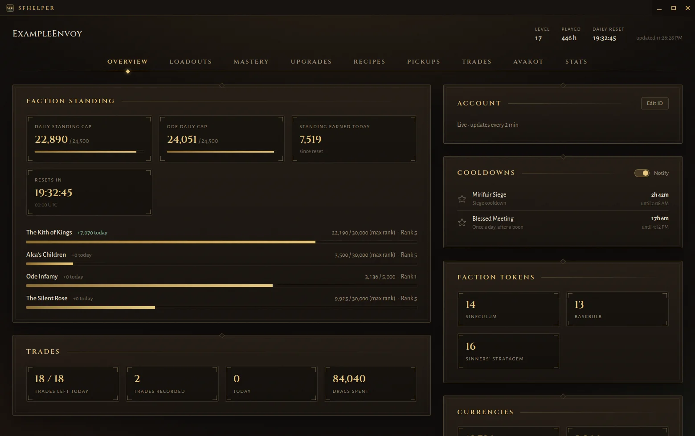

## Features

| Tab | What it shows |
|---|---|
| **Overview** | Faction standing and titles with each faction's in-game emblem, the daily standing cap counting down, standing earned today per faction, Enclave Favours and your currencies with their in-game icons (Dracs, Arcs, Harmonies) and a summary of your trades. Cooldowns: the game's own timers counting down, such as an Agari (sub-boss) respawning 30 minutes after you slay it, a siege's cooldown, the 3 hours before an Organ can be destroyed again, the 24 hours between Blessed Meetings, and your Wolfpup's rest after it runs out of Energy. Star a cooldown to get a desktop notification when it ends. When the Collector docks in your game, Cooldowns shows the region and when it leaves; star Collector Event to be notified. |
| **Loadouts** | Each loadout's Pact (with its Pact Arts tree), weapons, Runes, Totems by slot, Tempers and Joinery (e.g. *Gildaur: Thrice Blessed by Mora*), plus its armour (Helm, Cuirass, Leggings, with defence and Virtue requirements) and Talisman. Virtue totals match the Arsenal, with a breakdown: allocated points, Pact Arts, Talisman and Fables. Pact Arts show the game's own numbers (e.g. Forestall's chance to survive). Loadouts can be shared as short `SFH1:` codes; paste one and press Enter or Import. |
| **Mastery** | Your Envoy Rank, your Mastery and progress to the next rank, and the patch's maximum rank. Every weapon and Pact shows its in-game icon and its rank out of 30, from the game's own Mastery record, so a re-crafted weapon still counts. Filter by owned, mastered and type (Primary, Sidearm or Pacts). Discoveries lists every place by its in-game name and region, whether you've found it and the Memories found there, with a search and a filter by region or dungeon. |
| **Upgrades** | Split into Tempers, Runes, Joineries, Gear and Totems tabs. Tuvalkane temper learning, with each Temper's exact numbers from the game files (per weapon type where they differ) and a sort by Origin; your Runes by weapon art with their rank (1 to 4), the Totem slot they add and their numbers at that rank; your Joineries by metal and blessing, filterable by Virtue and blessing, with how many Attunement Pips each adds on hover; your Gear, with what's equipped and the numbers the game gives (e.g. a Virtue Elixir's +10 for an hour), filterable by type (Virtue Elixirs among them) and lures by Habitat and Nature (e.g. Lake, Bottom Feeder); and your Totems with owned / grip / Virtue / type filters, the kinds you don't own yet dimmed. Click a Totem's rank diamonds to see its numbers at any rank. Star a Totem you need for a build to get a desktop notification when you get one. Each subtab has the game's own icon, a search and a Sort by menu (e.g. Runes by weapon, Totem slot, name, rank or copies; Joineries by metal, Virtue, blessing, name or count). |
| **Recipes** | Everything you can brew with the Witch Verminia (Elixirs, Pup Treats and Palettes), the Chordstones Tuvalkane casts, and the weapons and armour you can craft: each recipe's ingredients against what you have, what you're short of, the Dracs and time it takes, and the Bond rank it needs. Search by recipe or ingredient, and filter by type, slot, Virtue, or by what's ready to make. Star a recipe to get a desktop notification once you have everything for it. |
| **Forge** | What you're crafting with Tuvalkane or Verminia, using the game's own words: each craft's curing time and how long is left (Ready To Claim, In Progress). Get a desktop notification when a craft is ready to claim. Temper Plans: every weapon you own, from Stock to Legendary, with its craftwork, rank and Tempers, plus the weapons you don't own yet (greyed out). Plan the 8 Temper slots a Legendary weapon holds (only Tempers that fit the weapon are offered) and see which planned Tempers are already struck, which still need striking, and which Tempers on the weapon aren't in the plan. Choose from every Temper or only the ones Tuvalkane has learned; planned Tempers you haven't learned yet are marked. Sort by craftwork, Tempers struck, rank, weapon type or name, and filter to owned, unowned or planned weapons. |
| **Pickups** | Weapons you've picked up, with their in-game pictures and times taken from the game's log. Optional desktop notifications for Moonsteel finds. Pickup and trade history is kept on your computer; export it to move it to a new install. |
| **Trades** | Your trade history: who you traded with, what you received and gave, with in-game icons (weapons with their craftwork and tempers), and the Scutage paid, worked out from the game's own tax table (220, 440 or 880 Dracs for each Common, Uncommon or Rare item you receive). Plus how many trades you have left today. |
| **Avakot** | What Avakot's Gots has in stock, with prices, purchase limits, how many of each you already own and how long each item stays, plus his weekly and always-stocked wares. SFHelper checks his stock every 3 hours. Star anything he can sell to get a desktop notification when he stocks it. |
| **Stats** | Your kills, headshots, assists and executions, deaths, revives and more; your weapons, Pacts and enemies by in-game name, with kills, headshots, assists, executions, time equipped and how often each enemy killed you, sortable by any column; and your Wolfpup: its Temperament, Energy, Training, the level trained in each skill (Guts, Speed, Endurance, Curiosity, Heart), and its food. After it runs out of Energy, the card shows when it can be summoned again, and Cooldowns lists it so you can star it for a notification. |
| **Settings** | Your account id; a switch to hide Founder's items (the weapons and Pacts from the Founder packs) from the Mastery and Stats tabs; and the colour theme: a few presets or your own colours, title bar included. |

## Screenshots

| | |
|---|---|
| 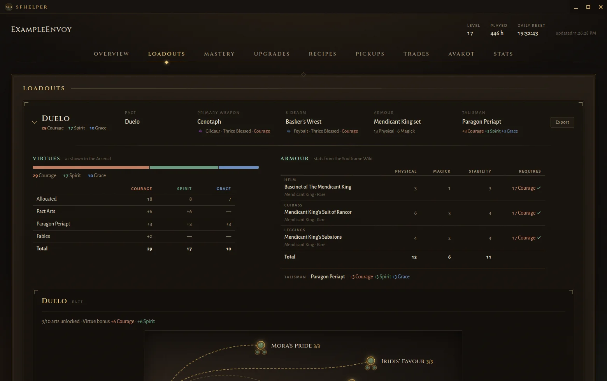 | 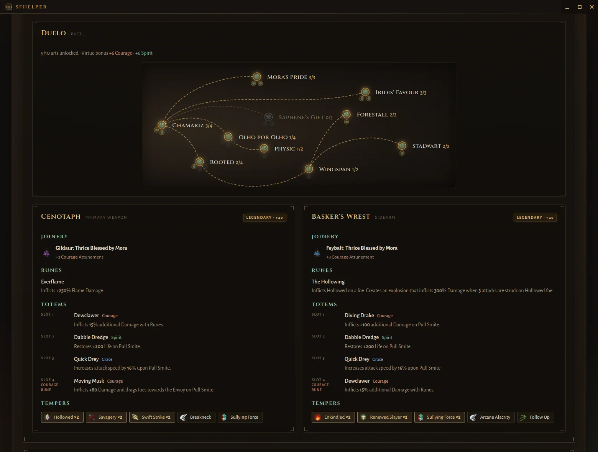 |
| 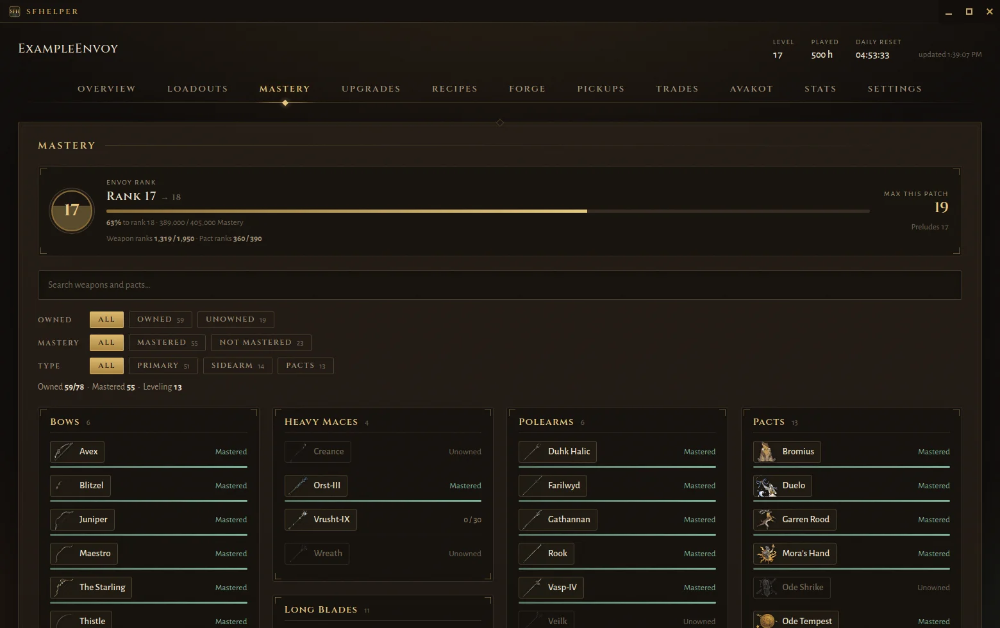 | 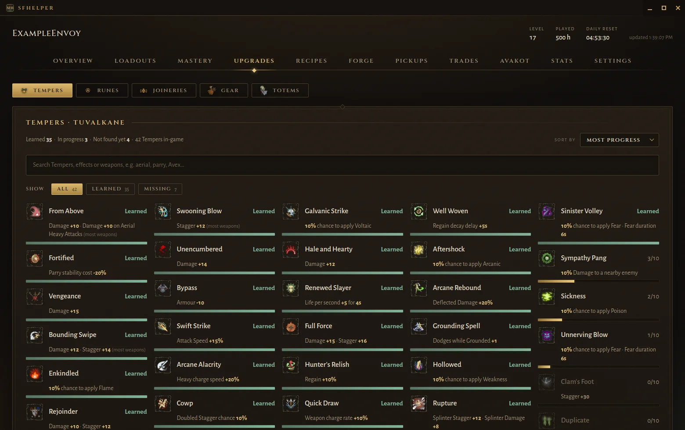 |
| 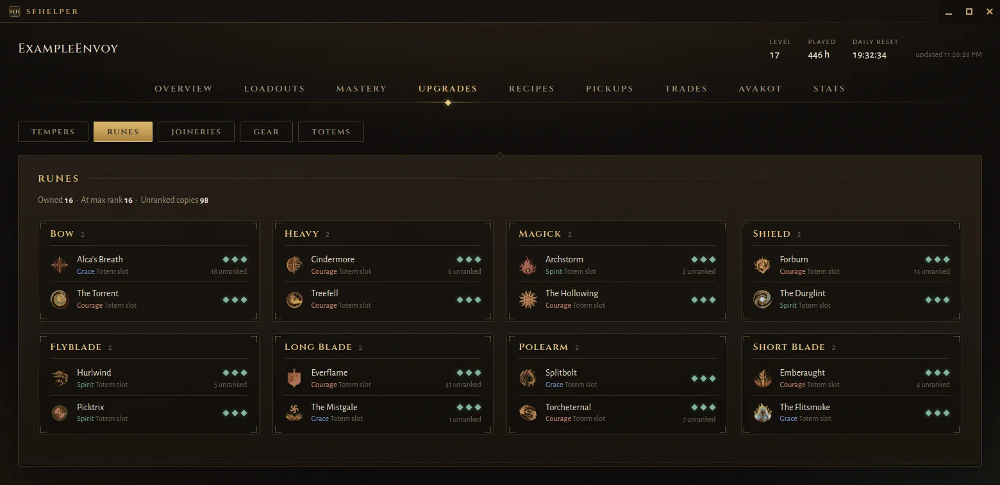 | 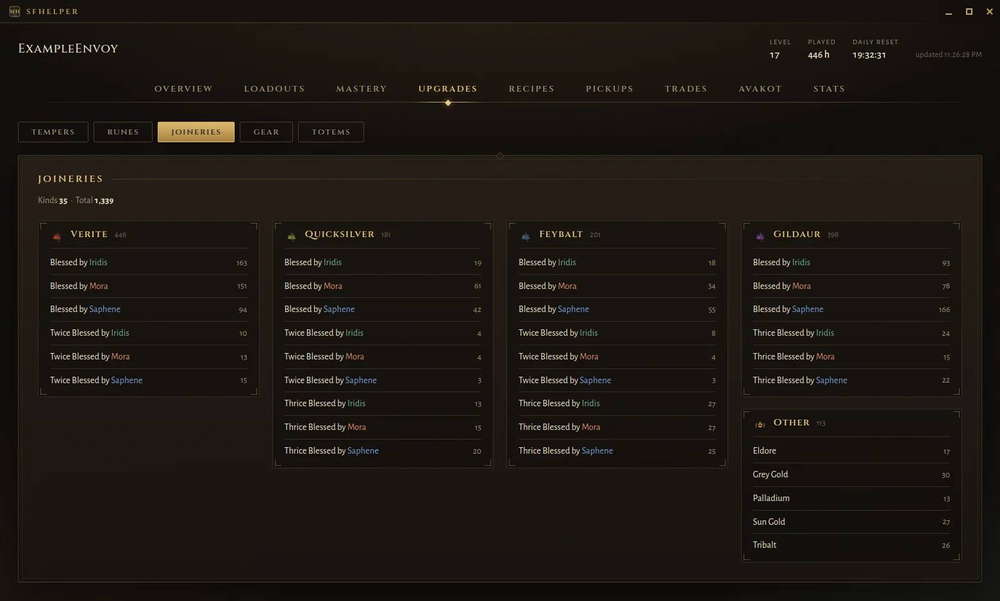 |
| 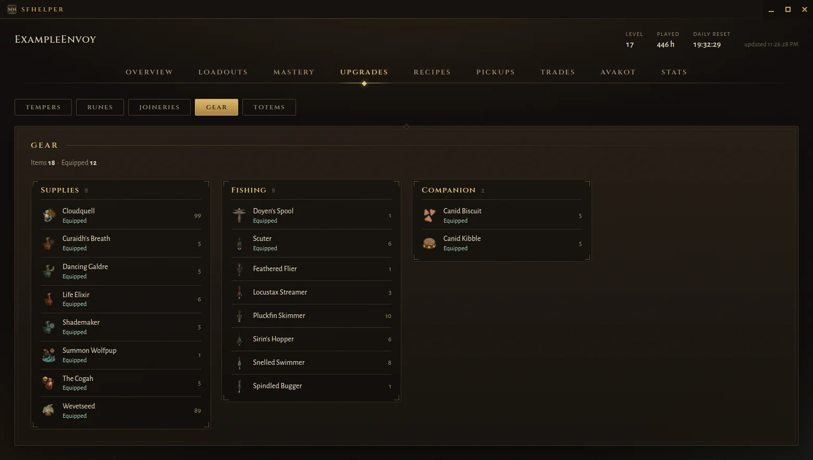 | 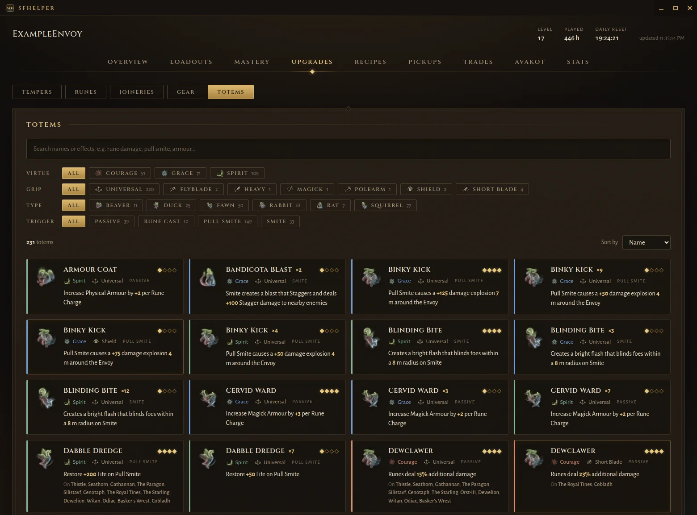 |
| 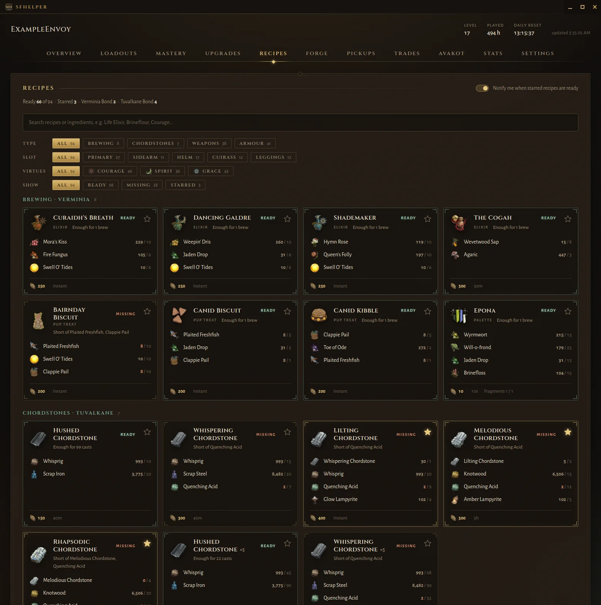 | 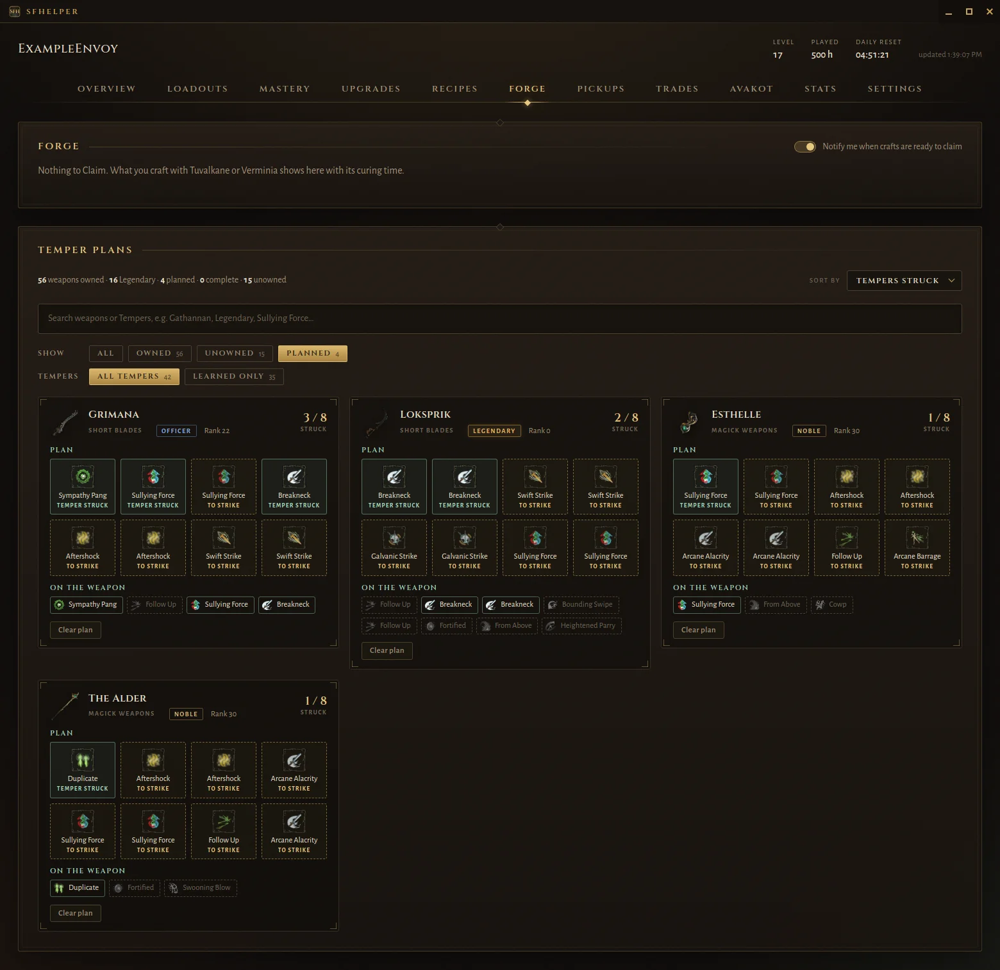 |
| 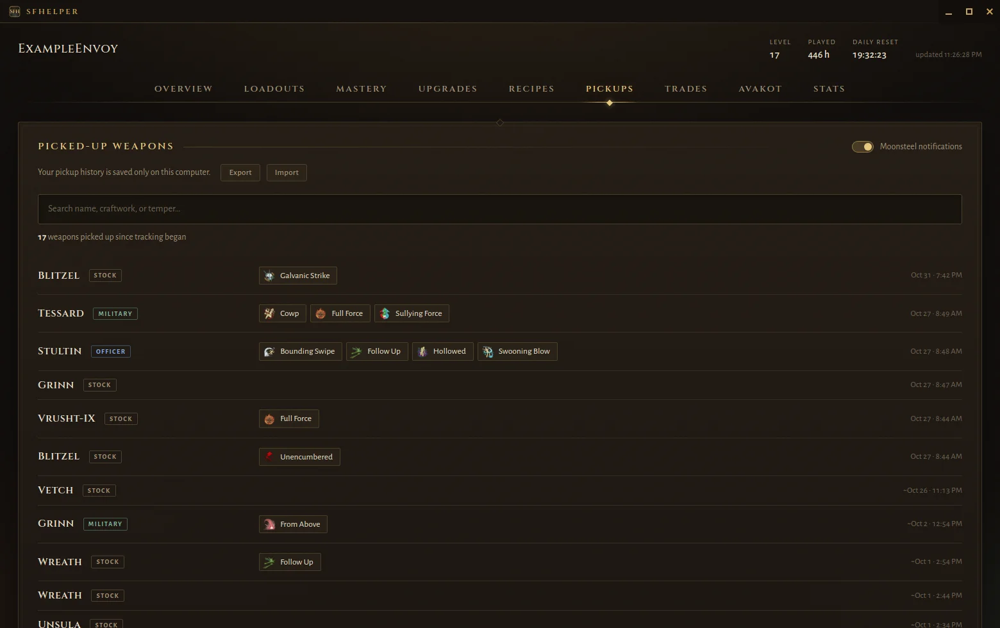 | 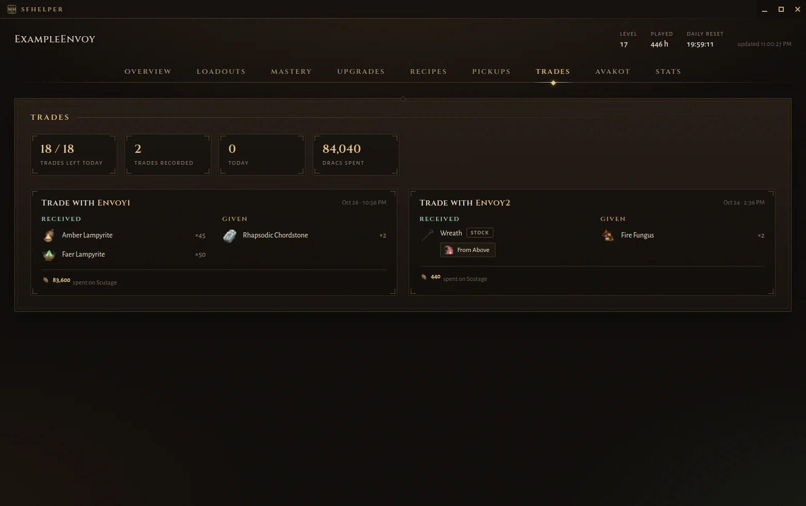 |
| 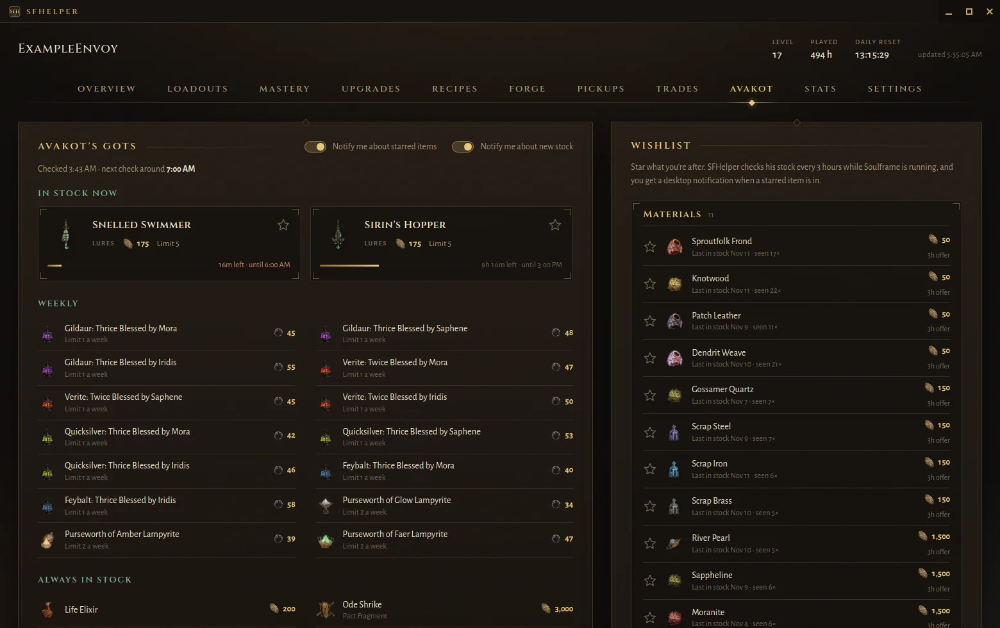 | 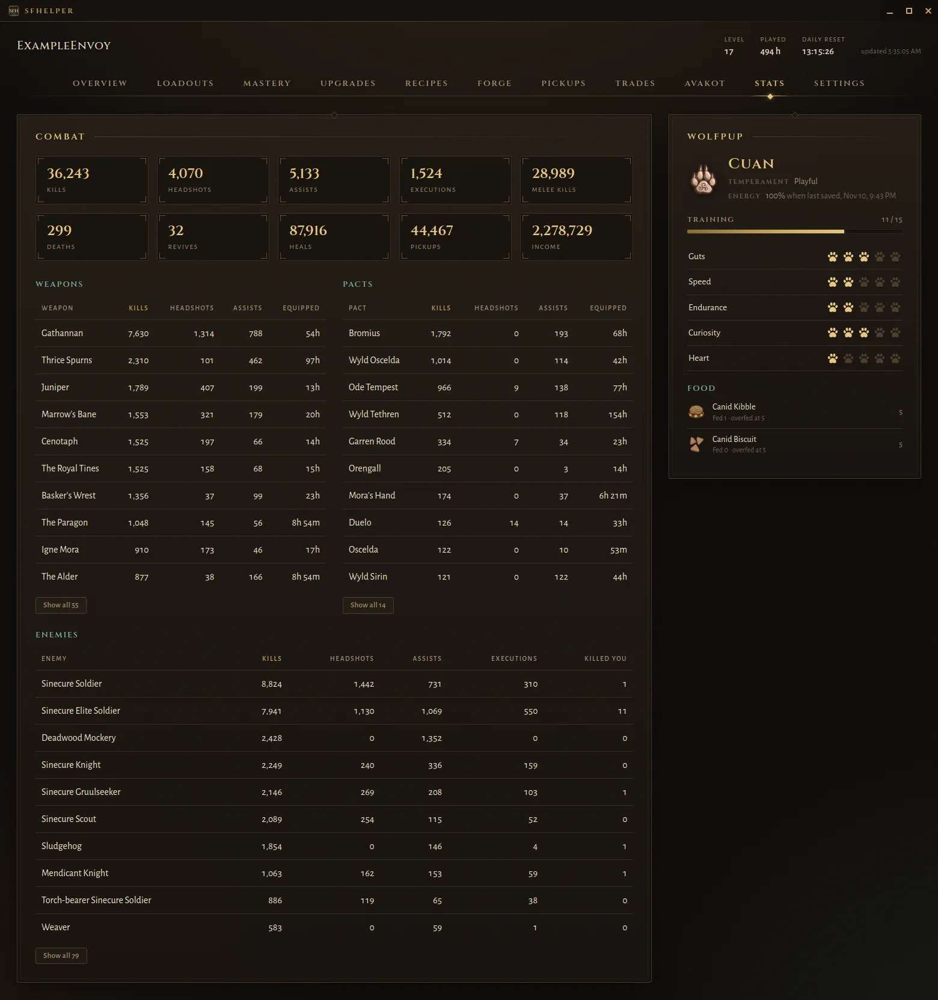 |

## How it gets your data

- **Public profile:** combat stats come from Soulframe's public profile
  endpoint. No login is involved. SFHelper asks for it at most every 20 minutes
  while Soulframe is running, and shows the last copy otherwise. Standing and
  level come from the inventory, so they stay current in between.
- **Inventory, read from the running game (desktop app, opt-in):** Soulframe
  doesn't offer the full inventory any other way, so the desktop app reads a
  session token from the game's memory and uses it to download your inventory.
  - Access is **read-only**: memory is opened without write rights, and there is
    no write path anywhere in the code.
  - Nothing runs until you agree on the first-launch consent screen.
  - The inventory is read once when you log in, then again only after the game
    itself saves it to Soulframe's servers (its log says when), at most every 10
    minutes. If the game saves nothing for 30 minutes, SFHelper reads it once
    anyway. The memory is only scanned when your session changes.
  - Around trades: once just before a trade if the game saved since the last
    read (so earlier loot isn't counted as part of the trade), and once just
    after each trade, so every trade is recorded on its own with exact amounts.
- **Avakot's shop (desktop app):** with the same session, the app asks
  Soulframe's server for Avakot's stock, the same request the game makes for his
  shop. It asks once every 3 hours while the game is running, a minute after an
  inventory import so the two never go out together. His offers change every
  hour and each stays for 3 hours, so none are missed. If the answer comes back
  before his stock has changed, it asks once more 10 minutes later.
- **Game log:** `EE.log` supplies the time each weapon was picked up, and each
  trade's partner and time. The Mastery figure the game writes at login is used
  to check SFHelper's own count (weapon and Pact ranks, plus 5,000 for each place
  whose History Motes are all found). Trades are detected by comparing inventory imports,
  so the history starts once SFHelper is running; trades made earlier in the
  same game session are recovered from the log.
- **Rate limits:** if Soulframe's servers ever refuse a request (403/429),
  SFHelper stops all requests to them, for 15 minutes at first and up to an hour.
  If the game's own requests are being refused (its log shows the 403s),
  SFHelper sends nothing until the game gets through again.
- **Only while you play:** SFHelper sends nothing to Soulframe's servers while
  the game isn't running.
- **Its own records:** SFHelper keeps a record of its own requests to
  Soulframe's servers (`requests.log`, the last 30 days) and of the times the
  game was refused (`refusals.log`), both only in its data folder.
- **Updates:** the app checks this repo's
  [GitHub releases](https://github.com/hunhow0x1/SFHelper/releases) for a newer
  version. The check sends nothing about you.

## Install and run

Download the latest build from the
[Releases page](https://github.com/hunhow0x1/SFHelper/releases/latest).

**Linux:** make the AppImage executable and run it. Keep it in a folder you
can write to, such as `~/Applications`, so it can update itself.

```bash
chmod +x SFHelper-<version>.AppImage
./SFHelper-<version>.AppImage
```

**Windows:** run `SFHelper-Setup-<version>.exe`.

Start Soulframe, log in to a character, then open SFHelper. It finds your
account by itself; there's nothing to type in.

### Updates

SFHelper checks for a new version at launch and every 6 hours, and
downloads it in the background. When it's ready, a banner offers **Restart to
update**; otherwise it installs the next time you quit. The footer shows your
version and has a **Check for updates** button.

The AppImage and the Windows installer update themselves.

### Your data and the log

Everything stays on your machine:

| | Folder |
|---|---|
| Linux | `~/.config/sfhelper/` |
| Windows | `%APPDATA%\sfhelper\` |

`sfhelper.log` in that folder records each session's imports and errors, and
`sfhelper.prev.log` the session before. They're the files to send when
something isn't working.

Your pickup and trade history exists only in that folder, because Soulframe's
servers don't keep it. Updating or reinstalling SFHelper keeps the folder, but
a new computer, another OS or a fresh system install starts the history over.
To keep it, click **Export** on the Pickups or Trades tab.
That saves one file with both histories and the Agari names SFHelper has
learned. On the new install, click **Import** and pick that file. Importing
adds what's missing and never removes or replaces anything, so it's safe to
import the same file twice.

### Troubleshooting

- **"Waiting for Soulframe…"**: the game isn't running, or you haven't logged
  in to a character yet.
- **Can't read the game's memory:**
  - Run SFHelper as the same user as the game.
  - On Windows, try **Run as administrator**.
  - On Linux, `/proc/sys/kernel/yama/ptrace_scope` may need to be `0`.
- **"Soulframe is refusing requests… Pausing until HH:MM"**: SFHelper is
  backing off after a refusal from Soulframe's servers. It retries on its own.
- **Red banner: "Soulframe's servers are refusing your game's requests"**:
  DE's servers are turning away requests from your network, the game's
  included, so the game can't save progress until it clears. SFHelper pauses
  its own requests and resumes by itself. If it lasts, contact DE support.
- **Red banner: "Soulframe's servers refused your game's login"**: the same
  block, hit at login. The game shows it as "Incorrect email or password", but
  your password is fine. SFHelper waits until the game logs in.

## Ground rules

- **Read-only.** SFHelper never writes to the game's memory, and is built so
  that it can't.
- **Opt-in.** The memory import doesn't run until you agree to it, and stops if
  you clear SFHelper's data.
- **No credentials.** SFHelper never asks for your Soulframe or Digital
  Extremes login.
- **Local.** Your data stays on your machine. Besides Soulframe's servers and
  the wiki, the only connection is the update check to this repo's releases.
- **Gentle on DE's servers.** Requests are cached, made one at a time, and
  stopped as soon as the servers say no.

## Support

SFHelper is free. If it's useful to you and you'd like to support its
development, you can do so through
[GitHub Sponsors](https://github.com/sponsors/hunhow0x1) or
[Ko-fi](https://ko-fi.com/hunhow0x1). It's entirely optional and doesn't
unlock anything.
